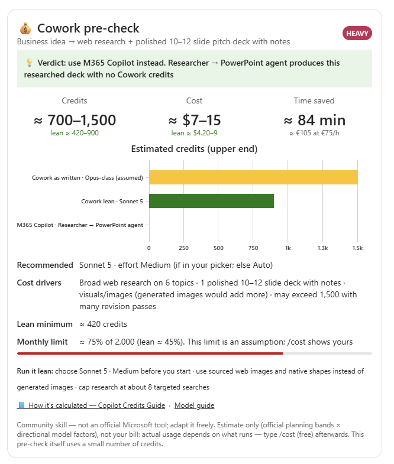
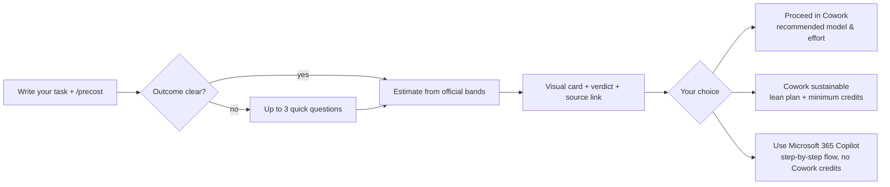
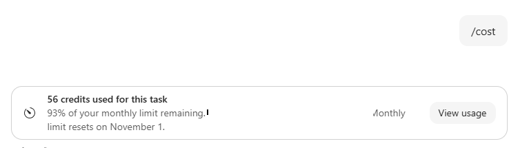

# Pre-cost — know what a Cowork task will cost *before* you run it

**Jump to:** [What you get](#what-you-get) · [How it works](#how-it-works) · [Install](#install-in-2-minutes) · [What's new in v3](#whats-new-in-v3) · [Where the numbers come from](#where-the-numbers-come-from) · [Make it yours](#make-it-yours) · [Limitations](#limitations) · [Contributing](#contributing) · [License](#license)

> [!IMPORTANT]
> **Pre-cost is not an official Microsoft skill or feature. It is a community
> example — use it as inspiration and adapt it to your own business needs.**
>
> All outputs are estimates, not bills. The real cost depends on the prompt,
> context, documents, tools, model, reasoning effort and runtime — check it
> afterwards with Cowork's free `/cost` command.

Pre-cost is a Copilot Cowork skill. Add `/precost` to a task and it estimates
the credits, cost and value *before* anything runs — then suggests the cheapest
good route: Cowork, Cowork lean, or Microsoft 365 Copilot.

---

## What you get

  

One compact card, then one question: how do you want to run it?

1. **Verdict** — ✅ Cowork as written · 🌱 Cowork, run it lean · 💡 Use M365 Copilot instead · ⚠️ Rescope first.
2. **Class badge** — Light, Medium or Heavy, from Microsoft's published task bands.
3. **Three tiles** — credits, ≈ USD and time saved, with the lean values underneath.
4. **Comparison chart** — Cowork as written vs. Cowork lean vs. the Microsoft 365 Copilot route.
5. **Recommended model + effort and source link** — plus cost drivers, the lean minimum, the share of a monthly limit and a link to the official Copilot Credits Guide.

---

## How it works

The skill never starts your task until you choose.

Want the details — the 7 steps, the lookup table and the verdict rules? See
[`docs/how-it-works.md`](docs/how-it-works.md).

---

## The check itself costs a little

> [!NOTE]
> In our test, a full pre-check (questions + card) used **56 credits (≈ $0.56)** —
> about 4–8% of the 700–1,500-credit task it evaluated. Your number will vary
> with model, effort and questions asked. Use `/precost lite` for a text-only
> summary.
>
> 

---

## Install in 2 minutes

1. Download [`precost-skill-v3.zip`](precost-skill-v3.zip?raw=1).
2. In Cowork: **Customize → Skills → Add → Upload skill** → select the zip
   (or attach it in a new Cowork chat and ask *"Install this as my skill named
   precost"*).
3. Start a new chat, write a task and add `/precost`.

**Skill not in the `/` list?** Open a new chat or reopen Cowork. If you edited
the description, keep it under 1,024 characters — Cowork ignores longer ones.

Prefer to read first? The same files live unzipped under [`skill/`](skill/) —
start with [`skill/SKILL.md`](skill/SKILL.md).

| File | What it holds |
|---|---|
| [`skill/SKILL.md`](skill/SKILL.md) | The 7-step workflow and guardrails |
| [`skill/pricing-reference.md`](skill/pricing-reference.md) | Your settings, billing facts, bands, model tiers, effort, lookup tables, sources |
| [`skill/value-and-routing.md`](skill/value-and-routing.md) | Time saved, verdict rules, routing table, Microsoft 365 Copilot recipes |
| [`skill/card-template.md`](skill/card-template.md) | The card layout and the lite-mode text summary |

---

## What's new in v3

- **Clarify first.** Up to 3 quick questions (outcome, scope, frequency) — only when the answer would change the estimate.
- **Visual card v3.** Verdict, class badge, three KPI tiles, a comparison chart, recommended model + effort and a link to the official source.
- **Three-way decision.** Proceed in Cowork · Cowork *sustainable* (lean plan, minimum credits, optional budget) · Microsoft 365 Copilot step by step.
- **Model tiers, not fixed names.** Efficient / Baseline / Premium / Auto, mapped to today's picker. Auto is the safe default.
- **Reasoning effort** (Light → Max) is now a cost lever.
- **Automations.** Scheduled and event-driven tasks show cost per run and per month.
- **Lite mode.** `/precost lite` returns a 7-line text summary for the cheapest possible check.
- **Opt-in and never runs your task by itself.** It waits for your choice and a "go". No CO₂ or energy claims.

Full details in [`CHANGELOG.md`](CHANGELOG.md).

---

## Where the numbers come from

| What | Value | Type |
|---|---|---|
| Light task | 100–300 credits (≈ $1–3) | Official band — Copilot Credits Guide |
| Medium task | 300–700 credits (≈ $3–7) | Official band — Copilot Credits Guide |
| Heavy task | > 700 credits (read as 700–1,500, flagged "may exceed") | Official band — Copilot Credits Guide |
| Credit price | $0.01 per credit, pay-as-you-go | Official |
| Model tiers | Efficient ×0.6 · Baseline ×1.0 · Premium ×2.0 · Auto ×0.6–1.0 | *Directional assumption* of this community skill — Microsoft does not publish per-model Cowork rates |
| Time saved | e.g. analysis & research ≈ 60 min, a document ≈ 24 min; valued at €75/h by default | Planning estimate |

The full tables are in [`skill/pricing-reference.md`](skill/pricing-reference.md)
and [`skill/value-and-routing.md`](skill/value-and-routing.md).

**Official sources**

- [Copilot Credits Guide](https://www.microsoft.com/licensing/guidance/CopilotCreditsGuide)
- [Usage-based billing & cost management](https://learn.microsoft.com/en-us/microsoft-365/copilot/usage-based-billing-overview-copilot-credits)
- [Everyday vs. advanced AI (USL vs. UBB)](https://learn.microsoft.com/en-us/microsoft-365/copilot/user-subscription-license-usage-based-billing)
- [The `/cost` command](https://learn.microsoft.com/en-us/microsoft-365/copilot/usage-based-billing-copilot-credits-cost)
- [Choose a model for Cowork](https://learn.microsoft.com/en-us/microsoft-365/copilot/cowork/cowork-models)
- [What's new in Cowork](https://learn.microsoft.com/en-us/microsoft-365/copilot/cowork/whats-new)
- [Microsoft 365 Copilot plans & pricing](https://www.microsoft.com/en-us/microsoft-365-copilot/pricing)

---

## Make it yours

Pre-cost answers a generic question: *is this task worth running in Cowork, and
how do I run it with fewer credits?* Your organization probably has a sharper
one. Change the questions, the numbers and the routes to fit how your business
works — in plain language inside Cowork, or by forking this repo. The
[upgrade guide](docs/UPGRADE-IDEAS.md) has ten ideas; two teasers:

**(a) Process-discovery questions for automations.** Ask about the trigger,
weekly volume, systems involved and human approvals, then show cost per run
and per month. A task that runs every weekday costs ~22× a one-off.

**(b) ROI questions that can flip the verdict to Cowork.** No Cowork credits
doesn't always mean cheapest overall — the Microsoft 365 Copilot route can cost
more of your own time.

| Weekly customer-account review | M365 Copilot route | Cowork (lean) |
|---|---|---|
| Your time per run | ≈ 35 min | ≈ 5 min to review |
| Credits per month (4 runs) | 0 | ≈ 720–1,680 (≈ $7.20–16.80) |
| Time value of the difference | — | 30 min × 4 runs ≈ **€150 / month** |

For that team, Cowork pays back even though it is metered.

---

## Limitations

- **Estimates are directional.** You get a band, not a bill.
- **The agent decides at runtime.** What runs can differ from what you asked.
- **Model availability depends on your tenant.** Admins can turn models on or off.
- **The budget is a target, not a cap.** Only admin spending limits cap spend.
- **No CO₂ figures.** "Sustainable" means the same outcome with fewer credits.

The real numbers are always `/cost` (free) and the Cost Management dashboard
after the task.

---

## Contributing

Issues and pull requests are welcome — better bands, clearer wording, new
routes. Please **never** include confidential data, internal links, tenant
names or private screenshots.

Earlier versions are kept under [`archive/`](archive/) ([v1](archive/v1/),
[v2](archive/v2/)).

---

## License

[MIT](LICENSE).
