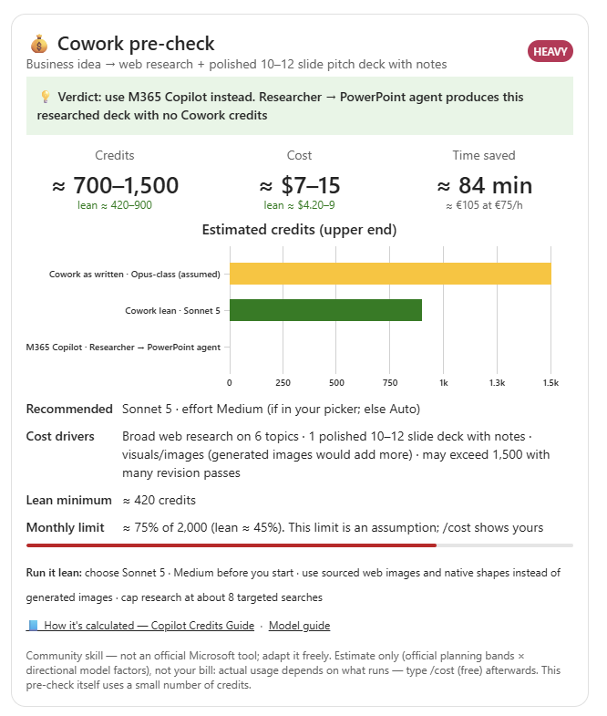
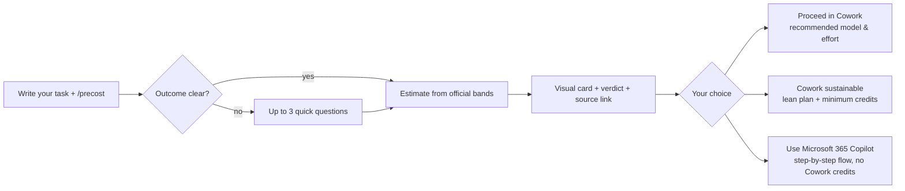
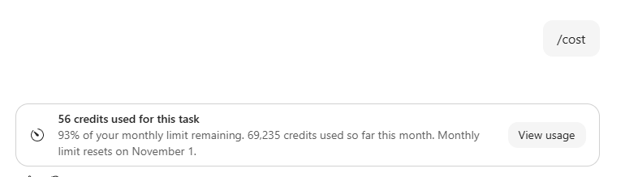

# Pre-cost — know what a Cowork task will cost _before_ you run it

**Jump to:** [What you get](#-what-you-get) · [How it works](#-how-it-works) · [Install](#-install-in-2-minutes) · [What's new](#-whats-new-in-v3) · [The numbers](#-where-the-numbers-come-from) · [Limitations](#-limitations)

> [!IMPORTANT]
> **Pre-cost is not an official Microsoft skill or feature. It is a community
> example — use it as inspiration and adapt it to your own business needs.**
>
> All outputs are estimates, not bills. The real cost depends on the prompt,
> context, documents, tools, model, reasoning effort and runtime — check it
> afterwards with Cowork's free `/cost` command.

Add `/precost` to a Copilot Cowork task. Before anything runs, you get a credit
range, a rough dollar cost, the time it saves, and the cheapest good route:
**Cowork as written**, **Cowork lean**, or **Microsoft 365 Copilot** (no Cowork
credits).

---

## 💰 What you get

  

1. **Verdict** — ✅ Cowork as written · 🌱 Cowork, run it lean · 💡 Use M365 Copilot instead · ⚠️ Rescope first.
2. **Class badge** — Light, Medium or Heavy, from Microsoft's official planning bands.
3. **Three tiles** — credits, ≈ USD and time saved (with a lean range when one applies).
4. **Comparison chart** — as written vs. lean vs. Microsoft 365 Copilot.
5. **Recommended model and effort**, top cost drivers, share of your monthly limit, and a link to the source.

---

## 🧭 How it works

The skill never starts your task until you choose. Step-by-step details are in
[`docs/how-it-works.md`](docs/how-it-works.md).

> [!NOTE]
> **The check itself costs a little.**
> In our test, a full pre-check (questions + card) used **56 credits (≈ $0.56)**,
> about 4–8% of the 700–1,500-credit task it evaluated. Your number will vary
> with model, effort and questions asked. Use `/precost lite` for a text-only
> summary.
>
>       alt="Cowork /cost result after running the pre-check: 56 credits used for this task.">

---

## 🚀 Install in 2 minutes

1. **[Download `precost-skill-v3.zip`](precost-skill-v3.zip?raw=1).**
2. In Cowork: **Customize → Skills → Add → Upload skill**, then select the zip.
   Or attach it in a new Cowork chat and ask: *"Install this as my skill named
   precost."*
3. Start a new chat, write a task and add `/precost`.

**Already have v1 or v2?** Remove the old `precost` skill in **Customize →
Skills** first, then upload v3.

**Skill not in the `/` list?** Open a new chat or reopen Cowork. If you edited
the description, keep it under 1,024 characters.

Want to read it first? The unzipped files are in [`skill/`](skill/). Start with
[`skill/SKILL.md`](skill/SKILL.md).

---

## ✨ What's new in v3

- **Asks before it guesses** — up to 3 quick questions (outcome, scope, frequency), only when the answer would change.
- **Model tiers and effort** — Efficient, Baseline, Premium or Auto, with a recommended model and reasoning effort.
- **Three routes, one choice** — proceed in Cowork, run it lean (with a lean minimum and an optional budget), or use Microsoft 365 Copilot.
- **Step-by-step M365 Copilot flows** — Researcher, Analyst, Word, PowerPoint and Excel agents, Outlook, Teams, Notebooks and scheduled prompts, with copy-paste prompts.
- **Automations priced per run and per month.**
- **Share of your monthly credit limit** on every card.
- **`/precost lite`** — a 7-line text summary instead of the card.
- **Cheaper and more transparent** — no web, mail or file lookups during the check; the card links its source and says the check itself uses a few credits.

Full list: [`CHANGELOG.md`](CHANGELOG.md).

---

## 📊 Where the numbers come from

| What | Value | Type |
|---|---|---|
| Light task | 100–300 credits | Official — Copilot Credits Guide |
| Medium task | 300–700 credits | Official — Copilot Credits Guide |
| Heavy task | > 700 credits (Pre-cost reads 700–1,500, "may exceed") | Official band; reading is this skill's assumption |
| Price | $0.01 per credit, pay-as-you-go | Official |
| Model tiers | Efficient ×0.6 · Baseline ×1.0 · Premium ×2.0 | **Directional assumption** — Microsoft does not publish per-model Cowork rates |
| Time saved | Typical minutes per task category, valued at €75/h by default | **Planning estimate** |

Official sources:
[Copilot Credits Guide](https://www.microsoft.com/licensing/guidance/CopilotCreditsGuide) ·
[Usage-based billing & cost management](https://learn.microsoft.com/en-us/microsoft-365/copilot/usage-based-billing-overview-copilot-credits) ·
[Everyday vs. advanced AI](https://learn.microsoft.com/en-us/microsoft-365/copilot/user-subscription-license-usage-based-billing) ·
[`/cost` command](https://learn.microsoft.com/en-us/microsoft-365/copilot/usage-based-billing-copilot-credits-cost) ·
[Choose a model for Cowork](https://learn.microsoft.com/en-us/microsoft-365/copilot/cowork/cowork-models) ·
[What's new in Cowork](https://learn.microsoft.com/en-us/microsoft-365/copilot/cowork/whats-new) ·
[Microsoft 365 Copilot plans & pricing](https://www.microsoft.com/en-us/microsoft-365-copilot/pricing)

All figures live in [`skill/pricing-reference.md`](skill/pricing-reference.md)
and [`skill/value-and-routing.md`](skill/value-and-routing.md).

---

## 🛠️ Make it yours

Pre-cost is meant to be copied and changed. Edit the settings table in
[`skill/pricing-reference.md`](skill/pricing-reference.md) §0 to set your hourly
rate, currency and monthly credit limit. Update the model list (§4) when your
picker changes. Swap the recipes in
[`skill/value-and-routing.md`](skill/value-and-routing.md) §4 for your
organization's own agents.

For example, a task that saves about 120 minutes is worth ≈ €150 at the default
€75/h. Compare that with ≈ $3–7 for a Medium Cowork task before you choose a
route.

---

## 🚧 Limitations

- **Estimates are directional.** You get a range, not a bill.
- **The agent decides at runtime.** What actually runs can differ from the plan.
- **Model availability depends on your tenant.** Recommendations say "if it appears in your model picker".
- **A budget is a target, not a cap.** Only admin spending limits cap spend.
- **No CO₂ figures.** "Sustainable" means the same outcome with fewer credits; there is no official per-task energy number.

---

## 🤝 Contributing

Issues and pull requests are welcome. Never include confidential data, internal
links or private screenshots.

Older versions: [`archive/v2/`](archive/v2/) · [`archive/v1/`](archive/v1/).

## 📄 License

[MIT](LICENSE).
