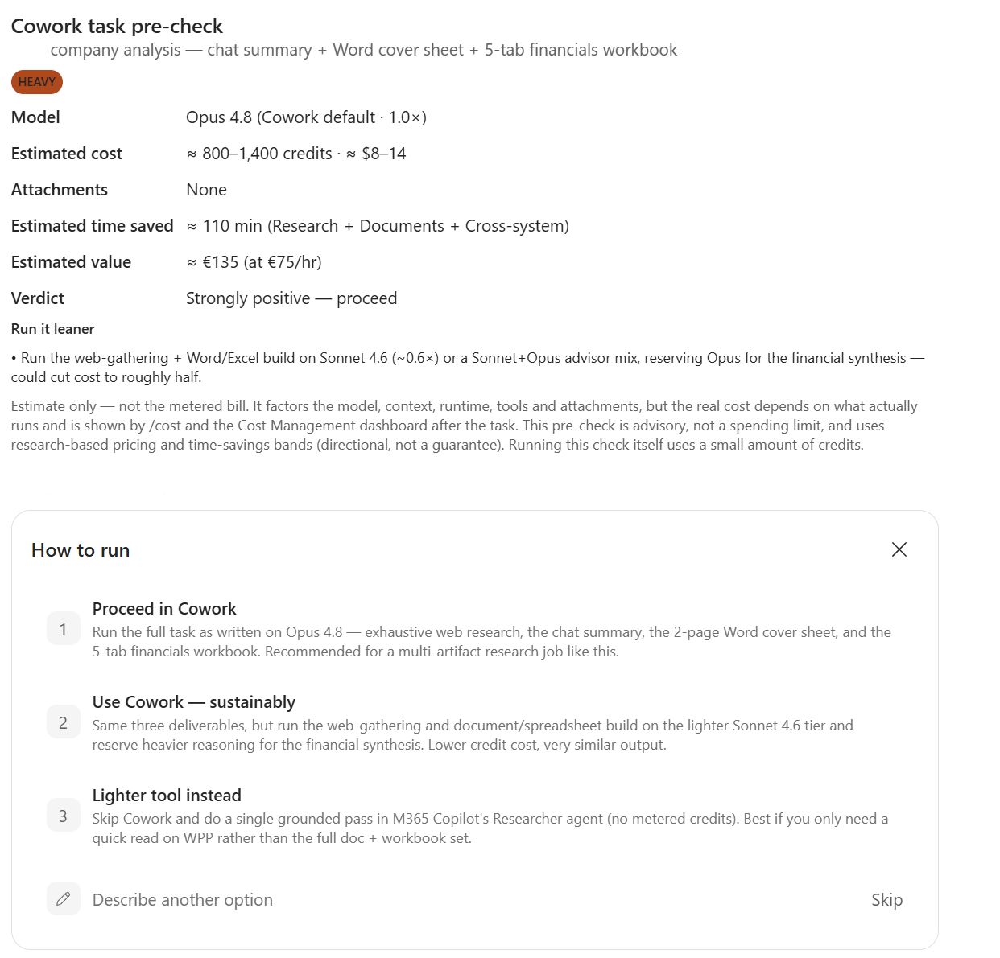
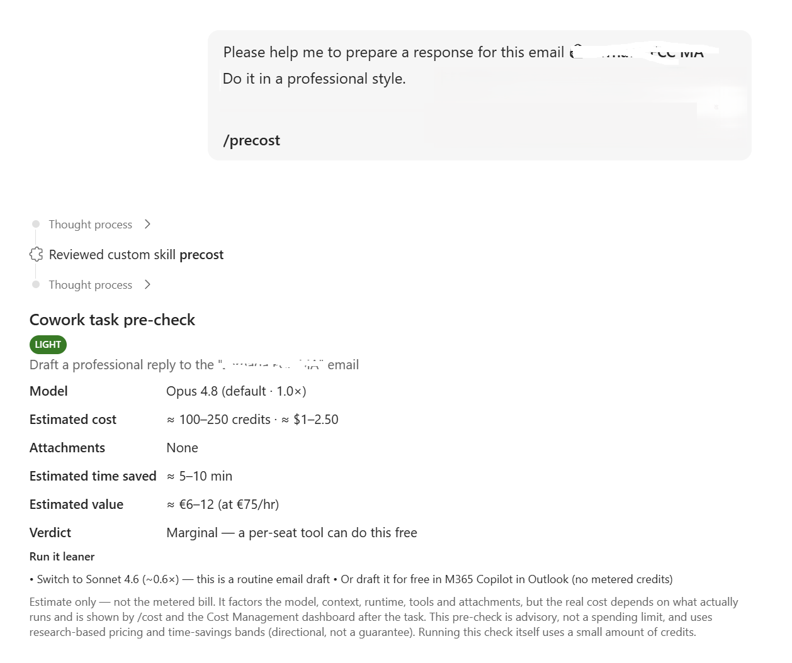
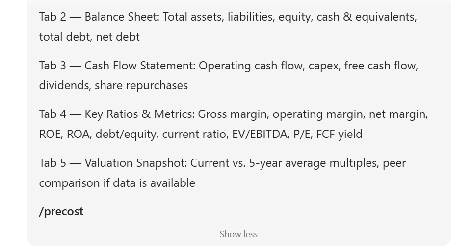

# Archive — v2

v2 (mid-2026), kept for reference. Use v3 at the repository root.

> Pre-cost is not an official Microsoft skill or feature. It is a community
> example — use it as inspiration and adapt it to your own business needs.

Do not install these files — use [`precost-skill-v3.zip`](../../precost-skill-v3.zip)
and the files under [`skill/`](../../skill/) instead.

## What's here

- [`precost-skill-v2.zip`](precost-skill-v2.zip) — the v2 downloadable bundle.
- [`skill/`](skill/) — the v2 skill files (main file named
  [`precost.md`](skill/precost.md); v3 renamed it to `SKILL.md`).
- [`docs/usage.md`](docs/usage.md) and [`docs/examples.md`](docs/examples.md) —
  the v2 usage guide and worked examples (v2 models, multipliers and verdicts).
- [`prompts/precost-system-prompt.md`](prompts/precost-system-prompt.md) — the
  v2 single-prompt version.

## v2 screenshots

These show the v2 card and are no longer accurate for v3.

See [`CHANGELOG.md`](../../CHANGELOG.md) for what changed in v3.
