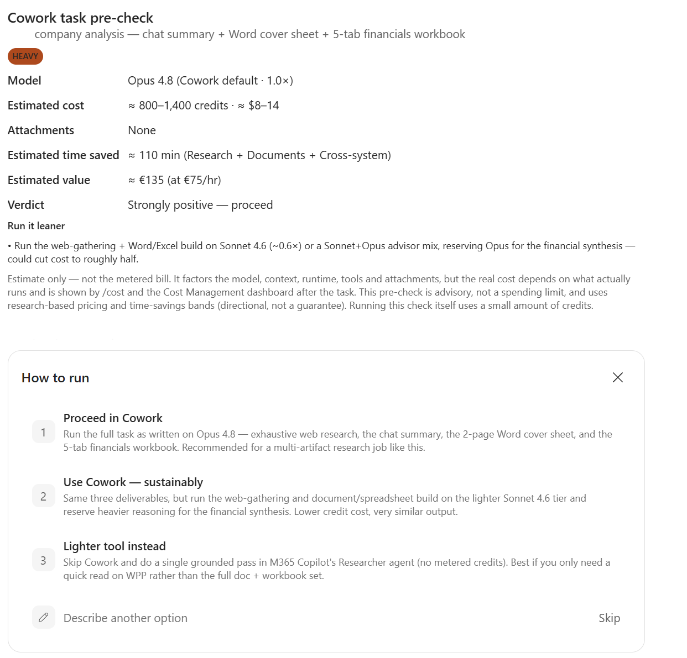
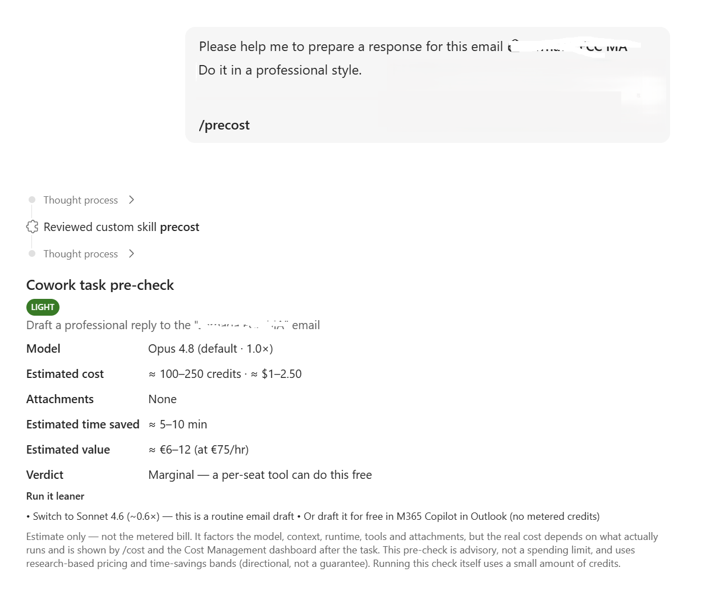
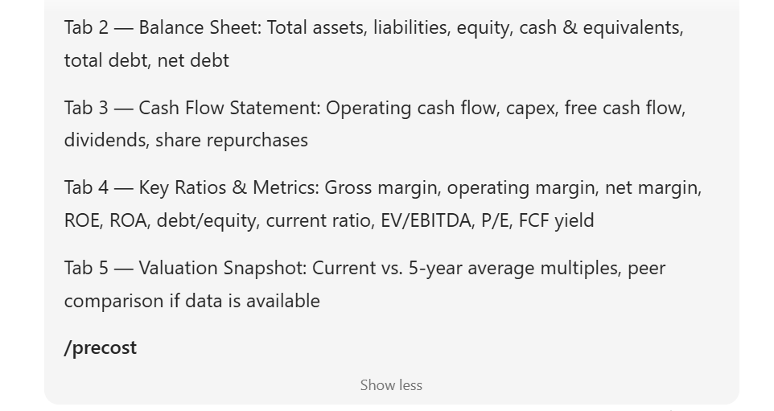

# v2 — archived

v2 (mid-2026), kept for reference. Use v3 at the repository root.

- `precost-skill-v2.zip` — the v2 bundle.
- [`skill/`](skill/) — the unzipped v2 files (main file `precost.md`).
- [`docs/usage.md`](docs/usage.md) and [`docs/examples.md`](docs/examples.md) — v2 usage guide and examples.
- [`prompts/precost-system-prompt.md`](prompts/precost-system-prompt.md) — v2 single-prompt version.

v2 screenshots (still in [`../../screenshots/`](../../screenshots/)):

To move to v3, see [`../../prompts/cowork-update-to-v3.md`](../../prompts/cowork-update-to-v3.md).
